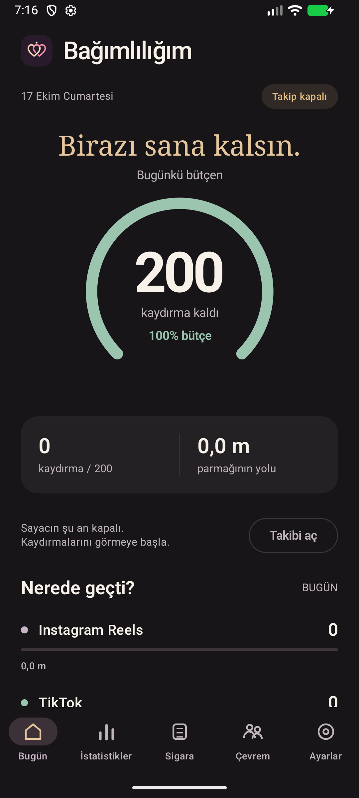
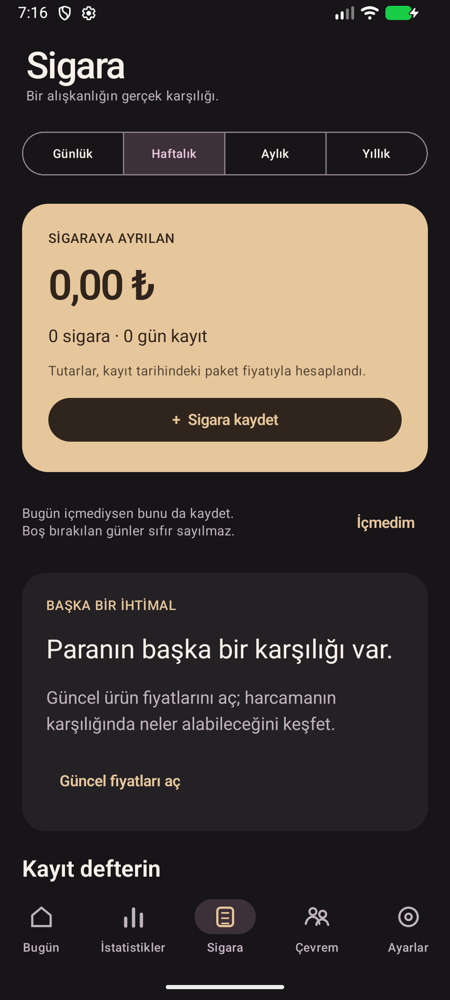
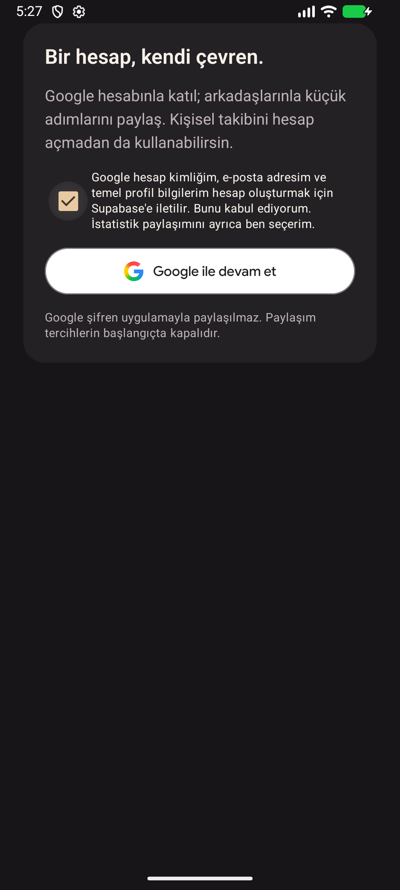

<p align="center">
  
</p>

<h1 align="center">Bağımlılığım</h1>

<p align="center"><strong>Birazı sana kalsın.</strong><br />Kaydırmalarını, alışkanlıklarını ve harcamalarını fark et.</p>

<p align="center">
  <a href="https://github.com/Emir-Gemici/Bagimliligim/actions/workflows/android.yml"></a>
  
  
  
  
</p>

<p align="center">
  <a href="#özellikler">Özellikler</a> ·
  <a href="#hızlı-başlangıç">Kurulum</a> ·
  <a href="docs/ARCHITECTURE.md">Mimari</a> ·
  <a href="ROADMAP.md">Yol haritası</a>
</p>

Bağımlılığım; kısa video kaydırmalarını, günlük bütçeni ve sigara harcamalarını tek yerde takip etmeni sağlayan Türkçe bir Android uygulamasıdır. Koyu tema, bağlı kalpler kimliği ve sade ekranlarla kişisel alışkanlıklarını görünür kılar. Temel takip hesap açmadan ve çevrimdışı çalışır; güncel fiyatlar ve arkadaşlarla paylaşım isteğe bağlıdır.

> **Geliştirme durumu:** `2.0.0` / sürüm kodu `3`, V2 test adayıdır. Google ile giriş ve arkadaş paylaşımının gerçek hesaplarla uçtan uca testi, fiziksel cihaz kabulü ve Play yayın hazırlıkları devam ediyor. Bu repo, uygulamanın Google Play'de yayımlandığı anlamına gelmez. Ayrıntılar: [V2 yayın notları](V2-RELEASE.md).

## Ekran görüntüleri

<p align="center">
  
  
  
</p>

<p align="center"><sub>V2 test adayından Bugün, Sigara ve Çevrem ekranları. Görseller emülatörden alınmıştır.</sub></p>

## Özellikler

- **Kısa video takibi:** Instagram Reels, TikTok ve YouTube Shorts için onaya bağlı kaydırma tahmini; günlük bütçe ve hatırlatmalar.
- **İstatistikler:** Platformlara ve günlere göre kaydırma geçmişi, eğilimler ve bütçe görünümü.
- **Sigara ve harcama kaydı:** Marka, adet, tarih ve paket fiyatıyla kayıt. Her kayıt kendi tarihindeki fiyatı korur; sonraki fiyat değişiklikleri geçmiş harcamayı değiştirmez.
- **Güncel fiyatlar:** Kaynak ve doğrulama tarihli fiyatlar, harcamanın başka karşılıklarını gösteren ürün önerileri. Güncelliği doğrulanamayan teklifler gösterilmez.
- **Çevrem:** Google ile isteğe bağlı giriş, arkadaş kodları, karşılıklı kabul ve ayrı ayrı seçilen özet paylaşımı. Canlı hizmet yapılandırması gerektirir.
- **Ana ekran bileşenleri:** 2×2 ve 4×2 widget, yeniden boyutlandırma ve elle yenileme.

## Gizlilik yaklaşımı

Kişisel takip kayıtları cihazdaki Room veritabanında tutulur. Erişilebilirlik servisi açık onayla etkinleşir; mesaj, hesap adı, video metni veya içerik açıklaması okunmaz. Ham erişilebilirlik olayları sunucuya gönderilmez. Sayım bir tahmindir; izlenme süresi ölçümü değildir.

V2, isteğe bağlı çevrimiçi özellikler için `INTERNET` izni içerir. Fiyat güncellemesi ve sosyal paylaşım başlangıçta kapalıdır. Google girişi özetleri kendiliğinden paylaşmaz; kullanıcı seçtiği son 14 günlük özetleri **Paylaş** düğmesiyle gönderir. Paylaşımı kapatma ilgili uzak özetleri, hesap silme ise ilişkili uzak hesap verilerini kaldırır.

Uygulamanın ayrıntılı sayım, saklama ve paylaşım davranışları [mimari belgesinde](docs/ARCHITECTURE.md) açıklanır.

## Hızlı başlangıç

### Gereksinimler

- Android Studio ve **JDK 17 veya 21**. Windows yardımcı betiği Android Studio'nun JBR 21 kurulumunu kullanabilir.
- Android SDK **Platform 36.1**, Build Tools **36.0.0**.
- Backend testleri için **Node.js 22** ve npm. CI, Node.js 22 kullanır.

Gradle **9.2.1** wrapper ile gelir. AGP **9.0.1** yerleşik Kotlin desteği kullanır; ayrıca `org.jetbrains.kotlin.android` eklenmez. Bağımlılık sürümleri [version catalog](gradle/libs.versions.toml) içinde sabitlenmiştir.

### Android

```bash
git clone https://github.com/Emir-Gemici/Bagimliligim.git
cd Bagimliligim
```

Projeyi Android Studio'da açıp SDK yolunu `local.properties` veya `ANDROID_HOME` ile tanımla. `local.properties` makineye özeldir ve Git'e eklenmez. Backend ayarı olmadan temel yerel takip özelliklerini derleyip kullanabilirsin.

**Windows / PowerShell:**

```powershell
.\scripts\build-windows.ps1 -Tasks ':app:assembleDebug',':app:testDebugUnitTest',':app:lintDebug',':app:verifyPrivacyManifests'
```

Bu yardımcı, Türkçe karakter içeren çalışma dizinleri için geçici ASCII sürücü eşlemesi oluşturur ve iş bitince kaldırır.

**macOS / Linux:**

```bash
./gradlew :app:assembleDebug :app:testDebugUnitTest :app:lintDebug :app:verifyPrivacyManifests
```

Debug APK: `app/build/outputs/apk/debug/app-debug.apk`. İlk derleme bağımlılıkları indirmek için ağ bağlantısı kullanır. Cihazda çalıştırmak için Android Studio'da API 26 veya üzeri bir cihaz seç.

### Backend testleri

```bash
cd backend
npm ci --ignore-scripts
npm test
```

Bu testler PGlite üzerinde SQL/RLS yetkilendirmesini, paylaşım sınırlarını ve fiyat davranışlarını doğrular; canlı Supabase hesabı gerektirmez. Canlı kurulum için [backend rehberini](backend/README.md) ve [Google giriş yapılandırmasını](backend/GOOGLE-SIGN-IN.md) izle.

Sosyal özellikli Android derlemesi `BAGIMLILIGIM_BACKEND_URL`, `BAGIMLILIGIM_PUBLIC_KEY` ve `BAGIMLILIGIM_GOOGLE_WEB_CLIENT_ID` ortam değişkenlerini kullanır. Örnek yapılandırma ve imzalı derleme adımları [geliştirme rehberinde](docs/DEVELOPMENT.md) yer alır. Sunucu yönetici anahtarı veya OAuth client secret APK'ya konmaz.

## Proje yapısı

```text
app/
  src/main/java/com/bagimliligim/app/
    domain/          Sayım, bütçe, para hesabı ve analitik
    data/            Room, DataStore ve uzak hizmet istemcileri
    presentation/    Compose ekranları ve ViewModel'ler
    service/         Erişilebilirlik ve bütçe hatırlatmaları
    widget/          Ana ekran bileşenleri
  src/test/          JVM birim testleri
  src/androidTest/   Cihaz ve emülatör testleri
  schemas/           Sürümlenen Room şemaları
backend/
  supabase/          SQL geçişleri, RLS ve saklama görevleri
  scripts/           Fiyat kataloğu ve canlı erişim kontrolleri
  test/              PostgreSQL yetki ve katalog testleri
branding/            Uygulama simgesi ve marka dosyaları
docs/                Mimari, geliştirme ve ekran görüntüleri
scripts/             Windows derleme ve imzalama yardımcıları
.github/             CI ve katkı şablonları
```

## Kontroller ve katkı

[Android checks](.github/workflows/android.yml), push ve pull request'lerde backend testlerini, Android debug/QA derlemelerini, JVM testlerini, lint, Android test APK'sı derlemesini, release bundle ve manifest izin kontrollerini çalıştırır. Raporlar Actions çıktılarında saklanır. Cihaz testleri ayrıca çalıştırılır; CI gerçek cihaz kabulünün yerine geçmez.

[Fiyat kataloğu iş akışı](.github/workflows/catalog.yml), gerekli repo değişkenleri ve sunucu secret'ı eklenip `BAGIMLILIGIM_CATALOG_ENABLED=true` seçilene kadar kapalıdır.

- [Katkı rehberi](CONTRIBUTING.md): değişiklik hazırlama ve doğrulama.
- [Geliştirme rehberi](docs/DEVELOPMENT.md): cihaz testleri, QA, imzalama ve yerel yapılandırma.
- [Yol haritası](ROADMAP.md): ürün yönü ve sonraki adımlar.
- [V2 yayın hazırlığı](V2-RELEASE.md) ve [Play test rehberi](PLAY-TEST.md): dağıtım durumu ve kabul kontrolleri.
- [Üçüncü taraf bildirimleri](THIRD-PARTY-NOTICES.md): görseller ve yazı tipi lisansları.
